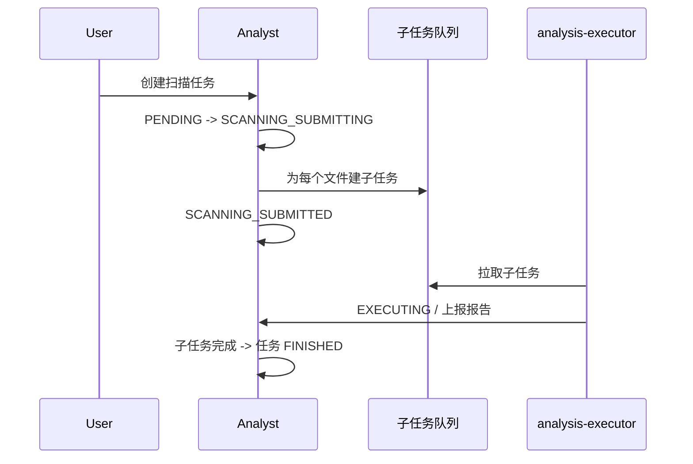

# 制品分析

> 最后更新：2026-09-14
>
> 修改扫描器、扫描任务、报告、质量规则时对照本文。用户侧步骤见 `docs/analyst/overview.md`。

## 模块定位

- **analyst 拥有**：扫描器配置、扫描任务/子任务、报告存取、质量规则、任务调度状态
- **analysis-executor 拥有**：拉取子任务、真正跑扫描器、回传结果
- **不拥有**：文件存储与节点创建；扫描读的是已有节点 + blob



同一文件 + 同一扫描器版本会复用报告，不再跑扫描。

## 目录

```text
src/backend/analyst/
├── api-analyst/
├── metadata-analyst/   # AnalystMetadataCustomizer：Generic 上传质量门禁
├── biz-analyst/        # ScanService、状态机、SubtaskPoller、报告
└── boot-analyst/

src/backend/analysis-executor/   # FileLoader + Trivy/Standard/Arrowhead 等 Executor
```

部署关系见 `docs/analyst/deployment.md`。

## 状态机

任务 `ScanTaskStatus`：`PENDING` → `SCANNING_SUBMITTING` → `SCANNING_SUBMITTED` → `FINISHED`（另有 `PAUSE` / `STOPPING` / `STOPPED`）。

超时的 `PENDING` / `SCANNING_SUBMITTING` 会被定时任务重提。

子任务经状态机：`CREATED`（超配额则 `BLOCKED`）→ `PULLED` → `EXECUTING` → 成功/失败。状态只能 `StateMachine.sendEvent()`，禁止直接改库字段。`SubScanTaskDao.updateStatus` 用 `lastModifiedDate` 做乐观锁。

`ScanExecutorFactory` 按 `"${Scanner.TYPE}Executor"` 找 Bean（如 `trivyExecutor`），类型字符串必须对上。Executor 用 `FileLoader`（`NodeService` + `StorageManager`）取文件；OCI/Docker 会拼 layer tar。`globalScan` 有 Redis 锁和 `maxGlobalTaskCount`。

`metadata-analyst` 的 `AnalystMetadataCustomizer` 只拦 Generic 上传；其他仓库类型走包版本钩子。扫描用临时 token 与 auth 的下载 token 不是同一套。

节点元数据 `scanStatus`（`INIT` / `RUNNING` / `STOP` / `UN_QUALITY` / `QUALITY_PASS` / `FAILED` / `QUALITY_UNPASS`）给前端展示。`ScanStatus` 枚举已 Deprecated，新代码用 `ScanTaskStatus`。

| 类 | 职责 |
|----|------|
| `ScanService` / `ScanServiceImpl` | 创建任务、流水线/全局扫描、接收 `ReportResultRequest` |
| `ScannerService` | 扫描器配置 |
| `ScanTaskStatus` | 任务状态 |
| analysis-executor | 执行与回包 |

通用统计进公共结果表；扫描器私有报告（如 arrowhead）在独立存储，不要塞进通用表。

## 禁止事项

- 不要绕过状态机改任务/子任务状态
- 不要在 analyst 进程里跑重扫描器；执行器也不要自己写 Mongo 报告库
- 不要对 `FAKE_SHA256` 的未完成分块节点开扫
- 不要拆掉 `globalScan` 的 Redis 锁
- 复用报告时不要清掉旧质量规则结论，除非扫描器版本变化
- 接口变更同步 `docs/apidoc/scanner/`

## 相关文档

- `docs/analyst/overview.md`、`docs/analyst/deployment.md`
- [generic.md](generic.md)、[repository.md](repository.md)

## 迭代记录

| 日期 | 变更 |
|------|------|
| 2026-09-14 | 初版；补状态机、Executor Bean 名、metadata-analyst 门禁 |
