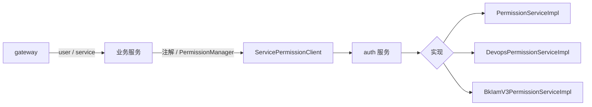

# 认证与授权

> 最后更新：2026-09-14
>
> 修改登录、账号、权限、临时 token，或业务接口鉴权时对照本文。

## 模块定位

- **auth 服务拥有**：用户、角色、平台账号、权限策略、OAuth、临时 token、对接蓝盾 / 权限中心
- **业务服务拥有**：在接口上声明并调用校验；实现集中在 `PermissionManager`（`common-metadata`），经 Feign 调 auth
- **网关拥有**：识别用户态 / 服务间、改写 URI；**不替代**资源级权限



实现由 `AuthServiceConfig` 按条件装配：`LocalAuthCondition` / `DevopsAuthCondition` / `BkV3RbacAuthCondition`。同一时刻只有一个 `PermissionService` Bean，不要再注册一个无条件实现。

仓库访问模式见 `TRepoAuthConfig`：`DEFAULT` vs `STRICT`。STRICT 下 Generic 仓要做路径级校验，不要改短路逻辑。临时 token 的 `permits` 递减必须走 `AuthTemporaryTokenDao.decrementPermits`（`findAndModify`），中心/边缘 token 实现不同，不能混用。

## 目录

```text
src/backend/auth/
├── api-auth/           # Feign API、权限 DTO、PermissionAction
├── biz-auth/
│   ├── service/local|bkdevops|bkiamv3|oauth/
│   └── config/AuthServiceConfig.kt
└── boot-auth/

src/backend/common/common-metadata/.../permission/PermissionManager.kt
src/backend/.cursor/rules/route-auth.mdc
src/gateway/lua/auth/
```

## 业务侧怎么鉴权

1. Controller：`@Principal` + `@Permission(type, action)`
2. 资源在路径里带 `projectId`/`repoName` 时，过滤器可做通用校验
3. 资源只在 Body/Query 时，必须在 Handler/Service 里显式 `PermissionManager` / `PermissionService.checkPermission`
4. 写操作 `WRITE`，读操作至少 `READ`

`PermissionManager` 还会处理外部权限回调、办公网/DevX 来源、Pipeline 仓库等特殊路径，不要在单个 Controller 复制一套。

## 关键类

| 类 | 职责 |
|----|------|
| `PermissionService` | auth 内权限接口 |
| `UserService` / `AccountService` / `RoleService` | 用户、平台账号、角色 |
| `TemporaryTokenService` | 临时访问 token |
| `PermissionManager` | 业务侧统一入口 |
| `AuthServiceConfig` | 选择本地 / 蓝盾 / IAM 实现 |

## 禁止事项

- 不要只在网关 Lua 做项目/仓库/节点鉴权然后让后端裸放行
- 路径无 `projectId/repoName` 时不要跳过校验（`route-auth.mdc`）
- 不要无条件再注册一个 `PermissionService`；内置角色常量（如 `AUTH_BUILTIN_ADMIN`、`PROJECT_MANAGE_ID`）不要改名
- 不要在 generic/repository 里直接查 `UserDao`
- 匿名用户是 `ANONYMOUS_USER`，公开仓库仍走既有公开逻辑
- 权限模型或错误码变更同步 `docs/apidoc/auth/`

## 相关文档

- 网关：`.cursor/rules/gateway.mdc`
- 接口：`docs/apidoc/auth/`

## 迭代记录

| 日期 | 变更 |
|------|------|
| 2026-09-14 | 初版；补 STRICT 模式、token permits、单 Bean 约束 |
