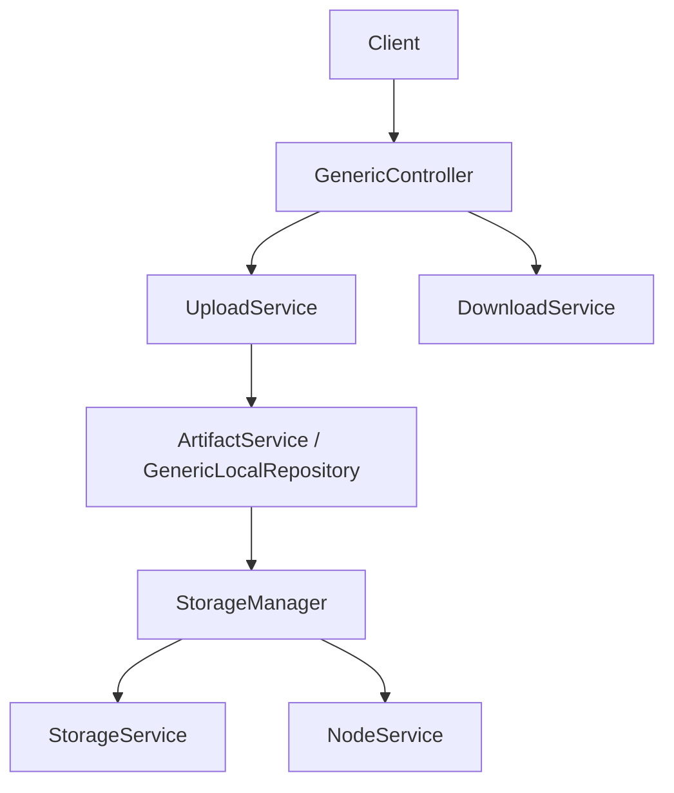

# Generic 制品服务

> 最后更新：2026-09-14
>
> 修改通用上传、下载、分块、临时访问时对照本文。

## 模块定位

- **拥有**：Generic 协议（简单上传、分块、分离分块、临时 URL、分享、增量同步）
- **不拥有**：节点/仓库元数据（[repository.md](repository.md)）、blob 落盘（[storage.md](storage.md)）、Maven/OCI 等专用协议（`src/backend/core/*`）

Generic 是「任意文件」仓库的默认实现，走 `common-artifact` 的 `ArtifactService` 模板。



## 目录

```text
src/backend/core/generic/
├── api-generic/
├── biz-generic/
│   ├── controller/          # GenericController、分块、临时访问、分享
│   ├── service/             # UploadService、DownloadService、CompressedFileService
│   └── artifact/            # GenericArtifactInfo、GenericLocalRepository
└── boot-generic/
```

同类协议（npm/maven/oci）复用 `common-artifact`，不要把 Generic 特有 Header 抄进它们。

## 主流程

### 简单上传 / 下载

1. 网关去掉 `/api/generic`，请求进 `GenericController`
2. `@Permission` + `PermissionManager` 校验仓库/节点权限
3. `UploadService` 组 `ArtifactUploadContext`，交给 `GenericLocalRepository`
4. `StorageManager.storeArtifactFile`：先 `StorageService.store(sha256)`，再 `NodeService.createNode`
5. 下载由 `DownloadService` 按节点 sha256 加载流，支持 Range

关键 Header：`X-BKREPO-OVERWRITE`、`X-BKREPO-EXPIRES`、`X-BKREPO-SIZE`、`X-BKREPO-CRC64ECMA`。

四种上传不要混用：

| 模式 | 触发 | blob | 建节点 |
|------|------|------|--------|
| 简单 PUT | 无特殊 uploadType | `StorageManager.storeArtifactFile` | 立即 |
| 传统分块 `/block/` | `uploadId` + `sequence` | 临时块 → `mergeBlock` | `completeBlockUpload` |
| 分离分块 | `uploadType=separate` | 每块按自身 sha256 | 完成时基节点用 `FAKE_SHA256`，块在 `TBlockNode` |
| Chunked | `uploadType=chunked` | `append` / `finishAppend` | finish 时 |

下载先走 `DownloadRedirectManager`（如 COS 预签名）；失败必须回落到 `onDownload()` 拉流，不要直接失败。加载资源由 `NodeResourceFactoryImpl` 选 `LocalNodeResource` / `FsNodeResource` / `RemoteNodeResource`。

`GenericLocalRepository.onUploadBefore()` 校验可选 Header `X-BKREPO-SHA256` / `MD5` / `CRC64ECMA`，不一致抛 `DIGEST_CHECK_FAILED`。Pipeline / custom 仓覆盖有额外规则（构建须在跑；流水线产物不能被普通 API 覆盖）。

### 临时访问

`TemporaryAccessController`、`ProxyTemporaryAccessController` 发短时 token。token 校验失败必须拒绝，不要回落到匿名下载。

## 关键类

| 类 | 职责 |
|----|------|
| `GenericController` | 用户态上传下载、批量下载、查询 |
| `UploadService` | 上传事务、分块、覆盖 |
| `DownloadService` | 下载与批量下载 |
| `GenericLocalRepository` | Generic 本地仓实现 |
| `ArtifactService` | 制品服务模板（common-artifact） |
| `StorageManager` | 存 blob + 建节点的唯一推荐入口 |

## 禁止事项

- 不要绕过 `StorageManager` 或等价两阶段逻辑；也不要绕过 `onUploadBefore()` 的校验
- 不要把 `/block/` 传统分块和 `separate` / `chunked` 当成同一套状态机
- 覆盖上传必须显式处理旧节点引用；分离分块进行中（节点带 `UPLOADID_KEY`）禁止覆盖
- Pipeline 仓库有额外限制（`PipelineRepoUtils` / `checkIfOverwritePipelineArtifact`）
- 接口变更同步 `docs/apidoc/generic/` 与 `docs/apidoc-user/generic/`

## 相关文档

- [storage.md](storage.md)、[repository.md](repository.md)、[auth.md](auth.md)

## 迭代记录

| 日期 | 变更 |
|------|------|
| 2026-09-14 | 初版；补四种上传模式、重定向回落、onUploadBefore |
