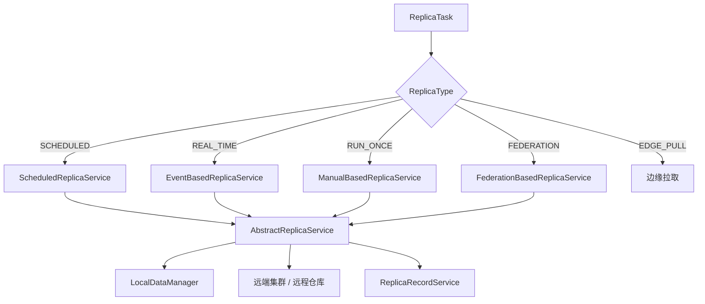

# 制品分发

> 最后更新：2026-09-14
>
> 修改跨集群同步、远程仓库、联邦仓库时对照本文。

## 模块定位

- **拥有**：集群节点、分发任务、执行记录、失败重试、联邦仓库、事件驱动同步
- **不拥有**：源站节点创建（[repository.md](repository.md)）、源站上传协议（[generic.md](generic.md)）
- **读取**：本地 `NodeService` / 包元数据，经 `LocalDataManager` 取源数据，再推到远端



## 目录

```text
src/backend/replication/
├── api-replication/
├── biz-replication/
│   ├── service/                 # ClusterNode、ReplicaTask、Record、Federation
│   ├── replica/type/            # 按 ReplicaType 的执行器
│   ├── replica/replicator/      # Replicator：推项目/仓/包/节点
│   ├── replica/repository/      # 本地/远端适配与类型 mapper
│   ├── manager/LocalDataManager.kt
│   ├── fdtp/                    # 大文件传输与鉴权
│   └── replica/context/         # ReplicaContext，一任务一集群一线程，勿跨线程共享
└── boot-replication/
```

## 任务与策略

`ReplicaType`：`SCHEDULED`、`REAL_TIME`、`RUN_ONCE`、`EDGE_PULL`、`FEDERATION`。

任务对象可以是路径约束或包版本约束。冲突策略见 `ConflictStrategy`，失败策略见 `ErrorStrategy`。改默认策略会影响存量任务，不要只改枚举不改文档。

| 类 | 职责 |
|----|------|
| `ReplicaTaskService` | 任务 CRUD / 启停 |
| `ReplicaRecordService` | 执行记录（中心/边缘实现不同） |
| `ClusterNodeService` | 集群节点 |
| `AbstractReplicaService` | 遍历对象、冲突处理、写记录 |
| `ReplicaRetryService` | 失败重试 |
| `LocalDataManager` | 读本地节点/包，避免执行器直接扫 Mongo |

中心与边缘记录实现不同（`CenterReplicaRecordServiceImpl` / `EdgeReplicaRecordServiceImpl`），改记录模型要两边一起看。

## 禁止事项

- 读本地数据只走 `LocalDataManager`，不要直接扫 repository 的 Mongo 集合
- 不要跨线程共享可变的 `ReplicaContext`
- 事件去重键是 `messageId + taskKey`（`EventRecordDao.tryInsertIfAbsent`），改了会重复同步
- 实时任务不要假设「写了节点就一定投递成功」
- 联邦同步有独立 metadata tracking，不要和 RUN_ONCE 混用状态机
- CENTER 用 appId/密钥，STANDALONE 用用户名密码，不要混用集群凭据形态
- FDTP token 必须与 `ServiceAuthManager` 对齐；包类型路径跟各 `*PackageNodeMapper` 走
- 接口变更同步 `docs/apidoc/replication/`

## 相关文档

- 用户接口：`docs/apidoc/replication/`
- 节点与存储： [repository.md](repository.md)、[storage.md](storage.md)

## 迭代记录

| 日期 | 变更 |
|------|------|
| 2026-09-14 | 初版；补 LocalDataManager、事件去重、FDTP、Context 线程边界 |
