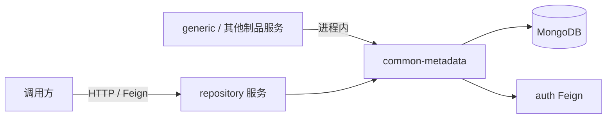
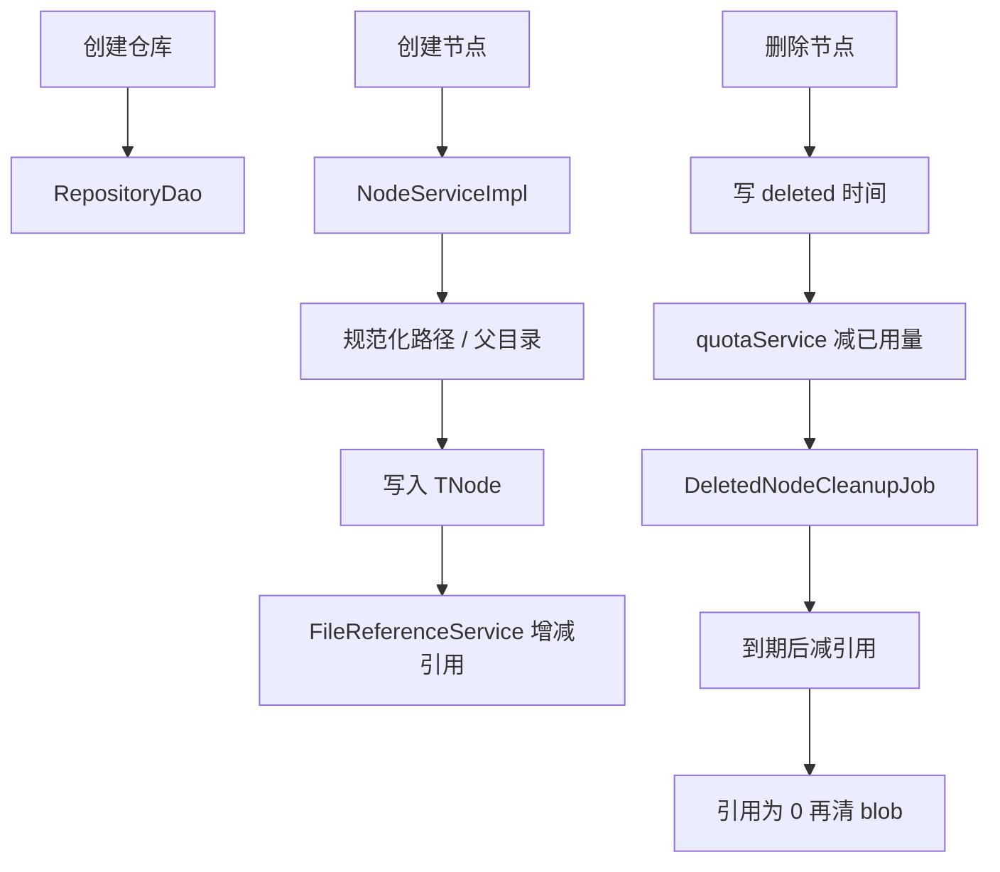

# 元数据：项目 / 仓库 / 节点

> 最后更新：2026-09-14
>
> 修改项目、仓库、节点、元数据时对照本文。不要把 blob 存进这个模块。

## 模块定位

- **拥有**：项目、仓库、节点树、包/版本元数据、文件引用计数、存储凭据配置、节点搜索
- **不拥有**：文件字节（见 [storage.md](storage.md)）、上传协议（见 [generic.md](generic.md)）、鉴权决策（见 [auth.md](auth.md)）

HTTP 入口在 `src/backend/repository`。`NodeService` / `RepositoryService` / `ProjectService` 的实现在 `src/backend/common/common-metadata`，被 generic、maven、replication 等服务直接依赖，不要只在 `biz-repository` 里再写一套。



## 目录

```text
src/backend/repository/
├── api-repository/     # 对外 DTO、Feign Client（如 RepositoryClient）
├── biz-repository/     # Controller；分享、收藏、软件源等扩展能力
└── boot-repository/

src/backend/common/common-metadata/
├── metadata-api/
└── metadata-service/
    ├── service/node|repo|project|packages|file|blocknode/
    ├── dao/
    ├── model/          # TNode、TRepository、TProject
    └── permission/     # PermissionManager（调 auth，不是鉴权源）
```

`biz-repository` 里还有分享、收藏、定时下载、软件源等，不属于节点核心写路径。

## 核心模型

| 实体 | 集合 | 要点 |
|------|------|------|
| `TProject` | `project` | 项目 |
| `TRepository` | `repository` | 唯一键 `projectId + name`；`credentialsKey` 指向存储凭据；`oldCredentialsKey` 用于迁移 |
| `TNode` | `node`（按 `projectId` 分片） | `folder` / `fullPath` / `sha256`；软删字段 `deleted`；唯一索引含 `deleted` |

节点业务主键是 `(projectId, repoName, fullPath, deleted)`，不是 Mongo `_id`。查未删除节点必须带上 `deleted` 条件。`TNode` 按 `projectId` 分片（`SHARDING_COUNT=256`），查询尽量带上分片键。`TFileReference` 同样按 digest/凭据分片。

建项目/仓库成功后由 `ResourcePermissionListener` 通知 auth / 权限中心授创建者权限。路径一律先 `PathUtils.normalizeFullPath`。`FAKE_SHA256` 节点（链接、分离分块基节点）不增减文件引用。

## 主流程



| 能力 | 入口 |
|------|------|
| 项目 CRUD | `ProjectService` |
| 仓库 CRUD / 配额 | `RepositoryService` |
| 节点增删改查、移动复制、重命名、恢复 | `NodeService` 及其 `Node*Operation` |
| 引用计数 | `FileReferenceService` |
| 分块节点 | `BlockNodeService` / `TBlockNode` |

## 禁止事项

- 核心 CRUD 改 `common-metadata`，不要在 `biz-repository` 再写一套 Node/Repo/Project
- 路径先 `PathUtils.normalizeFullPath`；禁止硬删根节点 `/`
- 删除默认软删，物理清理和引用递减交给 `DeletedNodeCleanupJob`（默认保留天数 `deletedNodeReserveDays`）
- 创建加配额、删除减配额必须成对；`FAKE_SHA256` 不加引用
- 不要去掉 `fullPath` 唯一索引里的 `deleted`
- 仓库 `credentialsKey` 变更要同时处理 `oldCredentialsKey`；配置里的密码更新要 `restoreMaskedPasswords`
- 路由没有 `projectId/repoName` 时不能只靠全局过滤器，见 `route-auth.mdc`

## 相关文档

- 用户接口：`docs/apidoc/repo/`、`docs/apidoc/node/`
- 存储： [storage.md](storage.md)

## 迭代记录

| 日期 | 变更 |
|------|------|
| 2026-09-14 | 初版；补软删清理任务、配额成对、FAKE_SHA256 不计引用 |
