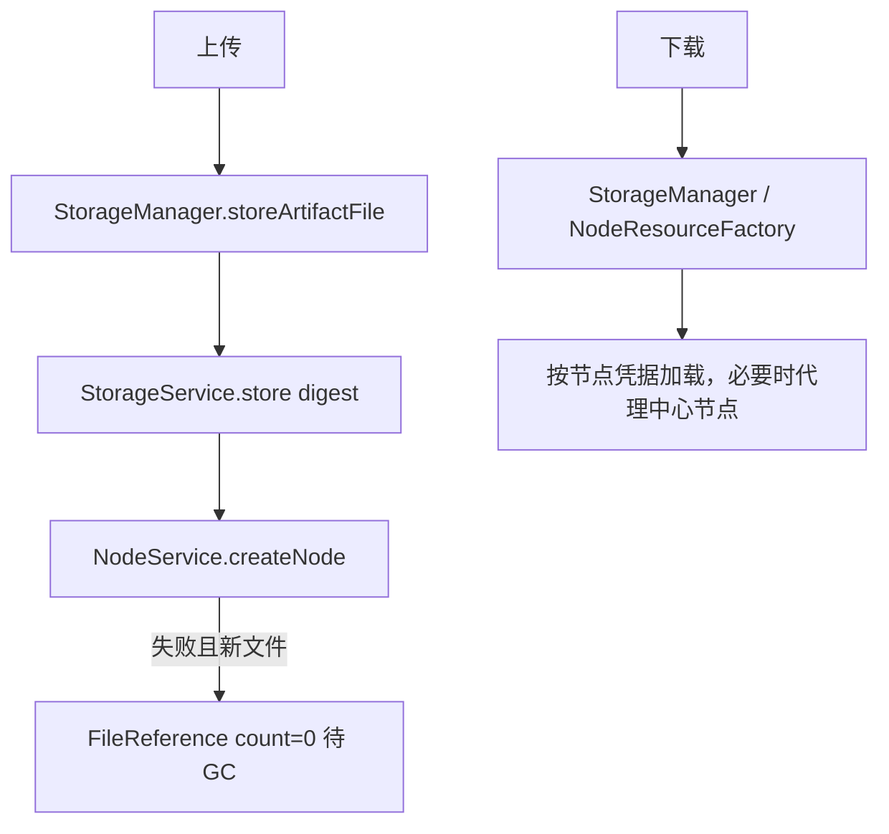

# 存储抽象

> 最后更新：2026-09-14
>
> 修改上传落盘、下载加载、缓存、清理、存储凭据时对照本文。

## 模块定位

- **拥有**：按 digest（通常 sha256）存取字节流、存储凭据、本地缓存、分块/压缩/健康检查
- **不拥有**：节点路径与项目仓库（[repository.md](repository.md)）、HTTP 上传协议（[generic.md](generic.md)）

制品服务应优先用 `StorageManager`，不要只调 `StorageService.load`。`StorageService` 只打指定凭据（必要时默认存储），**不会**处理迁移中的旧存储或其他集群。



## 目录

```text
src/backend/common/common-storage/
├── storage-api/        # StorageCredentials 及 FileSystem / InnerCos / HDFS / S3
└── storage-service/
    └── core/
        ├── StorageService.kt
        ├── AbstractStorageService.kt
        ├── FileStorage.kt
        ├── simple/SimpleStorageService.kt
        └── cache/CacheStorageService.kt

src/backend/common/common-artifact/artifact-service/
└── manager/StorageManager.kt
```

仓库上的 `TRepository.credentialsKey` 指向凭据；`null` 用默认存储。`notAllowRepoTypes` 默认排除 `DRIVE`，避免和 Drive 引用清理互相误删。

后端由 `StorageAutoConfiguration` 按 `storage.type` 选 `FileSystemStorage` / `InnerCosFileStorage` / `S3Storage`；`HDFS` 当前不支持。默认凭据若 `cache.enabled` 则装配 `CacheStorageService`，否则 `SimpleStorageService`。落盘路径由 `HashFileLocator` 按 digest 前缀切目录（`/ab/cd/{sha256}`），改算法会找不到存量文件。

`LocalNodeResource` 加载顺序：当前凭据 → copy 源 → `oldCredentialsKey` → 触发归档/解压恢复。传统分块临时布局是 `{uploadId}/{sequence}.block` + `.sha256`，`mergeBlock` 依赖这个约定。

## 关键接口

| 类型 | 用途 |
|------|------|
| `StorageService.store/load/delete/exist/copy` | 按 digest 操作指定存储 |
| `FileBlockOperation` | 分块 |
| `CompressOperation` / `OverlayOperation` | 压缩与 overlay |
| `CleanupOperation` / `HealthCheckOperation` | 清理与探活 |
| `FileReferenceService` | digest + credentialsKey 的引用计数 |
| `CacheStorageService` | 本地缓存加速；缓存不是源数据 |

`store` 返回影响行：已存在为 0，新写入为 1。`StorageManager` 用这个值决定节点创建失败时要不要补 0 引用。

## 禁止事项

- 业务下载不要直接 `StorageService.load`；走 `StorageManager` / `NodeResourceFactoryImpl`
- 不要按路径存文件，也不要改 `HashFileLocator` 切分规则
- 引用未到 0 不要删 blob；`store` 对已存在 digest 返回 0，不会改写字节
- 不要让 DRIVE 仓库与普通仓库共用同一套清理任务理解的存储
- 跨存储 `copy` 在目标已存在或源目标相同时是空操作，不要当成失败重试
- 加密走 `AbstractEncryptorFileStorage`，换密钥会读不回旧 blob
- 垃圾文件靠 `StorageReconcileJob` 对账，不要在请求线程里扫盘删除

## 相关文档

- [generic.md](generic.md)、[repository.md](repository.md)

## 迭代记录

| 日期 | 变更 |
|------|------|
| 2026-09-14 | 初版；补 AutoConfiguration、HashFileLocator、加载回退链 |
